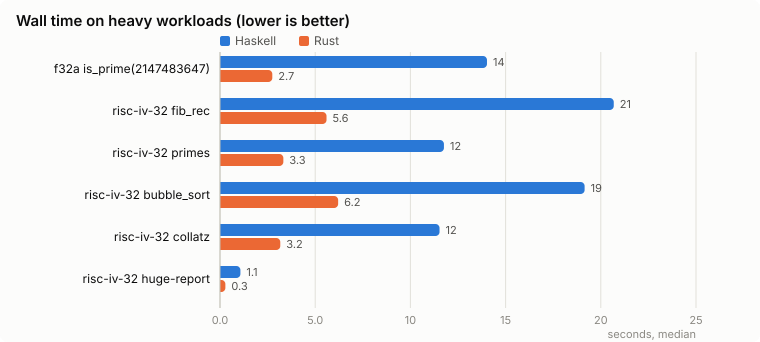
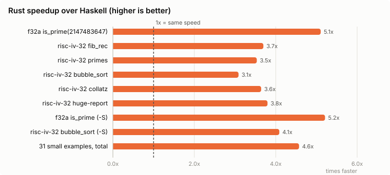
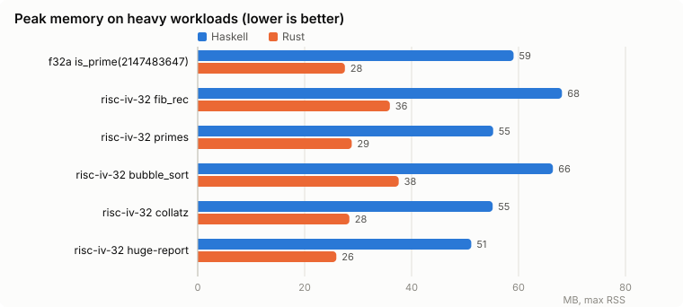

# Performance: Haskell vs Rust

How the Rust rewrite of `wrench` compares to the original Haskell implementation on the same programs and configs.

| | |
| --- | --- |
| **3.7x faster** | heavy simulations, total wall time (77 s -> 21 s) |
| **3.8x faster** | a huge step-by-step report (`slice: all`) |
| **1.9x less memory** | peak RSS on the heavy workloads |
| **4.6x faster** | small examples, mostly process startup (~6 ms -> ~1 ms per run) |
| **4.5x faster** | translation only (`-S`) |







## Setup

- Haskell: `0.0.6.2`, the last Haskell commit (`10eb83a`), built with `stack build --ghc-options -O2` in the `ryukzak/wrench-builder` image.
- Rust: `wrench 0.6.2`, built with `cargo build --release`.
- Host: AMD Ryzen 5 5500GT with Radeon Graphics, 12 CPUs, Linux-7.2.11-arch1-1-x86_64-with-glibc2.44. A shared machine with other services running, so expect a few percent of noise.
- Each case runs once as warmup, then the median wall time of 5 runs (heavy) or 30 runs (small and `-S`) is taken. Memory is the max RSS over the runs.
- RSS shown as `<= 15` means the process stayed under the memory the benchmark driver itself had when it started the process, so the real value is lower.

## Workloads

Heavy programs live in this directory. Each reads `n` from `0x80`, writes the result to `0x84` and asserts it, so both versions are checked to compute the same thing.

| program | ISA | what it does |
| --- | --- | --- |
| [`bubble_sort.s`](bubble_sort.s) + [`bubble_sort.yaml`](bubble_sort.yaml) | risc-iv-32 | bubble sort of 1400 LCG words, checksum sum(a[i] * (i + 1)) - loads/stores |
| [`collatz.s`](collatz.s) + [`collatz.yaml`](collatz.yaml) | risc-iv-32 | total Collatz steps for 1..10000 - branches and shifts |
| [`program.s`](program.s) + [`conf.yaml`](conf.yaml) | f32a | assert is_prime(2147483647) == 1 |
| [`fib_rec.s`](fib_rec.s) + [`fib_rec.yaml`](fib_rec.yaml) | risc-iv-32 | naive recursive fib(27) - calls and stack traffic |
| [`primes.s`](primes.s) + [`primes.yaml`](primes.yaml) | risc-iv-32 | count primes below 50000 by trial division - mul/rem |

The small examples are every `example/<isa>/*.yaml` with its program, and `-S` runs only translation.

## Results

### Simulation, heavy compute

| case | Haskell, ms | Rust, ms | speedup | Haskell RSS, MB | Rust RSS, MB | exit code |
| --- | ---: | ---: | ---: | ---: | ---: | :---: |
| f32a is_prime(2147483647) | 14022.5 | 2747.2 | 5.10x | 59.1 | 27.5 | 0 |
| risc-iv-32 fib_rec | 20680.3 | 5594.7 | 3.70x | 68.1 | 35.9 | 0 |
| risc-iv-32 primes | 11761.3 | 3327.4 | 3.53x | 55.3 | 28.8 | 0 |
| risc-iv-32 bubble_sort | 19149.8 | 6205.1 | 3.09x | 66.4 | 37.6 | 0 |
| risc-iv-32 collatz | 11530.6 | 3166.2 | 3.64x | 55.2 | 28.4 | 0 |
| **total** | **77145** | **21041** | **3.67x** | | | |

### Simulation, heavy report (`slice: all`)

| case | Haskell, ms | Rust, ms | speedup | Haskell RSS, MB | Rust RSS, MB | exit code |
| --- | ---: | ---: | ---: | ---: | ---: | :---: |
| risc-iv-32 huge-report | 1071.7 | 282.2 | 3.80x | 51.2 | 25.9 | 0 |
| **total** | **1072** | **282** | **3.80x** | | | |

### Simulation, small examples (startup dominated)

| case | Haskell, ms | Rust, ms | speedup | Haskell RSS, MB | Rust RSS, MB | exit code |
| --- | ---: | ---: | ---: | ---: | ---: | :---: |
| acc32/factorial-5 | 5.1 | 1.2 | 4.14x | 25.1 | <= 15 | 0 |
| acc32/get-put-char-87 | 5.3 | 1.0 | 5.17x | 26.1 | <= 15 | 0 |
| acc32/get-put-char-ABCD | 5.4 | 1.0 | 5.28x | 26.1 | <= 15 | 0 |
| acc32/hello | 7.7 | 1.4 | 5.37x | 27.4 | <= 15 | 0 |
| acc32/not-true | 6.9 | 1.1 | 6.43x | 27.3 | <= 15 | 0 |
| f32a/factorial | 8.3 | 2.2 | 3.75x | 27.3 | <= 15 | 0 |
| f32a/hello | 7.4 | 1.4 | 5.34x | 27.5 | <= 15 | 0 |
| f32a/not-true | 6.6 | 1.1 | 6.23x | 27.5 | <= 15 | 0 |
| m68k/factorial-5 | 4.9 | 1.1 | 4.34x | 24.7 | <= 15 | 0 |
| m68k/factorial-recursive-2 | 4.7 | 1.1 | 4.34x | 24.7 | <= 15 | 0 |
| m68k/factorial-recursive | 4.8 | 1.1 | 4.36x | 24.7 | <= 15 | 0 |
| m68k/get-put-char-87 | 6.8 | 1.5 | 4.48x | 27.4 | <= 15 | 0 |
| m68k/hello-byte | 7.1 | 1.5 | 4.70x | 27.4 | 15.8 | 0 |
| m68k/hello | 7.0 | 1.5 | 4.68x | 27.5 | 15.8 | 0 |
| m68k/not-true | 6.8 | 1.4 | 5.04x | 27.3 | 15.8 | 0 |
| risc-iv-32/factorial-5 | 5.0 | 1.3 | 3.69x | 25.1 | 15.8 | 0 |
| risc-iv-32/get-put-char-87 | 6.6 | 1.5 | 4.49x | 27.6 | 15.8 | 0 |
| risc-iv-32/get-put-char-ABCD | 7.1 | 1.4 | 5.04x | 27.3 | 15.8 | 0 |
| risc-iv-32/hello | 6.8 | 1.5 | 4.52x | 27.6 | 15.8 | 0 |
| risc-iv-32/not-true | 6.7 | 1.4 | 4.64x | 27.3 | 15.8 | 0 |
| risc-iv-32/random-memory-init | 4.0 | 1.0 | 4.02x | 23.6 | 15.8 | 0 |
| vliw-iv/factorial-5 | 6.8 | 1.9 | 3.56x | 27.2 | 15.8 | 0 |
| vliw-iv/hello | 7.0 | 1.6 | 4.37x | 27.4 | 15.8 | 0 |
| vliw-iv/test-parallel | 7.2 | 1.5 | 4.67x | 27.3 | 15.8 | 0 |
| wasm32/factorial-5 | 5.7 | 1.5 | 3.73x | 25.7 | 15.8 | 0 |
| wasm32/factorial-recursive-5 | 5.7 | 1.5 | 3.76x | 25.8 | 15.8 | 0 |
| wasm32/frames | 4.7 | 1.3 | 3.69x | 24.4 | 15.8 | 0 |
| wasm32/get-put-char-87 | 5.6 | 1.1 | 4.93x | 26.4 | 15.8 | 0 |
| wasm32/get-put-char-ABCD | 6.8 | 1.1 | 6.10x | 27.4 | 15.8 | 0 |
| wasm32/hello | 7.6 | 2.0 | 3.79x | 27.1 | 15.8 | 0 |
| wasm32/not-true | 6.5 | 1.1 | 5.69x | 27.4 | 15.8 | 0 |
| **total** | **194** | **43** | **4.57x** | | | |

### Translation only (`-S`)

| case | Haskell, ms | Rust, ms | speedup | Haskell RSS, MB | Rust RSS, MB | exit code |
| --- | ---: | ---: | ---: | ---: | ---: | :---: |
| f32a is_prime | 9.1 | 1.7 | 5.21x | 28.4 | 15.8 | 0 |
| risc-iv-32 bubble_sort | 12.4 | 3.0 | 4.09x | 31.6 | 15.8 | 0 |
| **total** | **22** | **5** | **4.50x** | | | |

## Reproduce

```shell
cargo build --release --bin wrench
# build the Haskell wrench from commit 10eb83a, e.g. in the ryukzak/wrench-builder image
python3 script/perf_compare.py path/to/haskell/wrench target/release/wrench test/performance/results.json
python3 script/perf_report.py test/performance/results.json test/performance
```

Raw numbers: [`results.json`](results.json).
